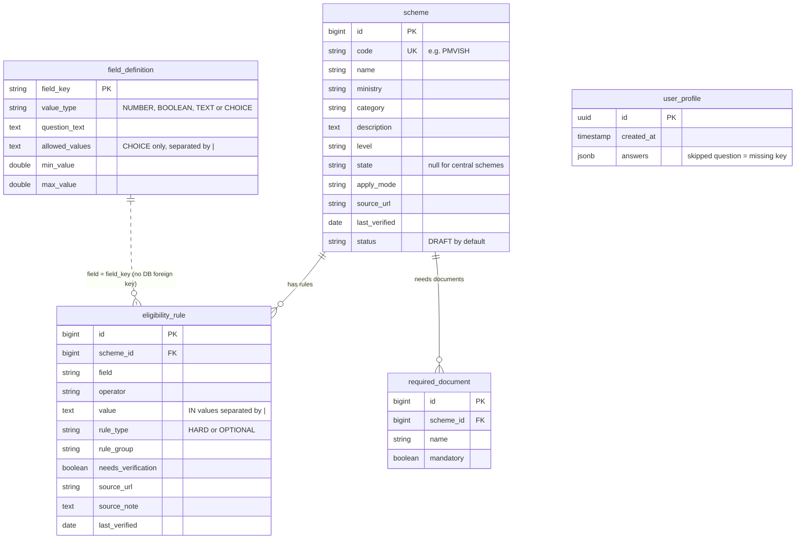

# CivicPilot

An agentic assistant that helps people find and apply for government welfare schemes.

> **Status:** Week 1 (data and intake API) is complete. The eligibility engine is next.

## Tech stack
- Java 21, Spring Boot, Spring Data JPA
- PostgreSQL (pgvector) via Docker Compose

## Prerequisites
- Java 21
- Docker

## How to run

```bash
docker compose up -d
./mvnw spring-boot:run
```

Then open http://localhost:8080/health

### Loading the scheme data
On first run, set `civicpilot.seed.enabled=true` in `application.properties`. The seeders load 12 schemes, 55 eligibility rules and 40 field definitions from the CSV files in `data/`. They are safe to run again.

## API

### `POST /profiles`
Saves a user's intake answers and returns a profile ID. Every answer key must be a known field from `field_definition`. Skipped questions can be sent as `null` or left out.

```bash
curl -i -X POST http://localhost:8080/profiles \
  -H "Content-Type: application/json" \
  -d '{"answers": {"age": 25, "is_pregnant": true}}'
```

Success returns `201` with the new profile ID:

```json
{"id": "6e7669e6-7f3f-45b4-8dbb-3d7d8e0dbc07"}
```

Invalid input returns `400` and lists **all** problems at once:

```json
{"errors": ["Unknown field: height", "age: must be at most 120.0"]}
```

## Tests

```bash
./mvnw test
```

The validation rules for profile answers are covered by unit tests in `ProfileServiceTest`.

## Database schema



## Roadmap
1. Data and intake API (done)
2. Eligibility engine and explanations
3. Documents, RAG, and application guidance
4. Interface, deployment, and case study